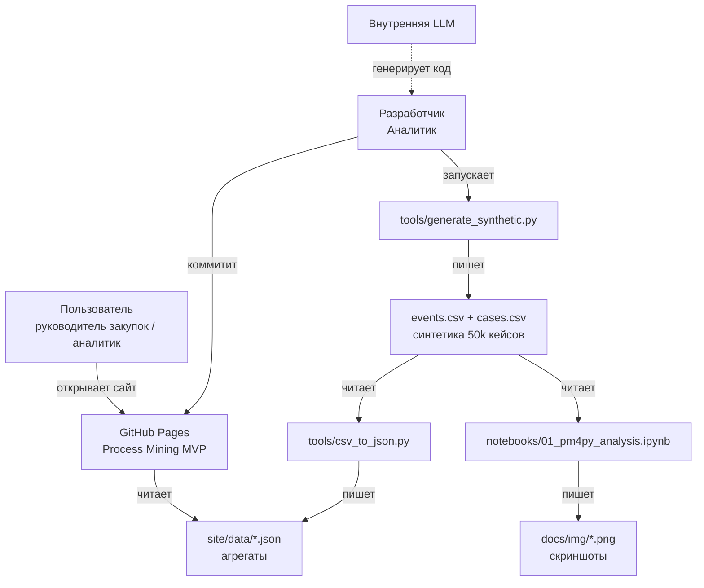
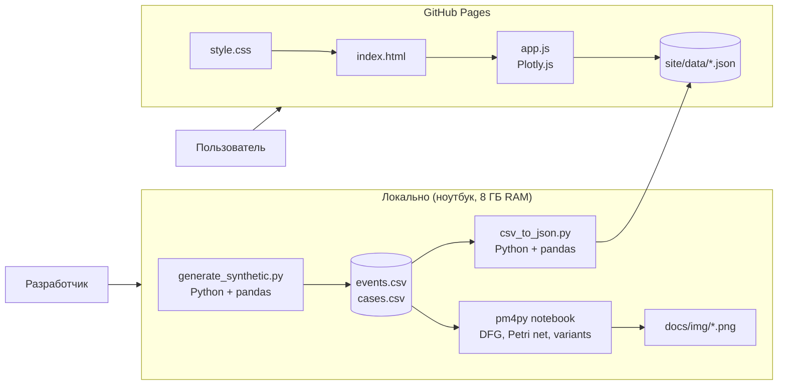

# C4-диаграммы: Process Mining MVP

Этот документ — C4-диаграммы проекта. Он показывает контекст системы (кто пользователи, какие внешние системы) и контейнеры (какие скрипты и сайты входят в архитектуру).

**Уровни:** Context (L1), Container (L2).

---

## C4 Level 1 — System Context

**Акторы:**
- **Пользователь** — руководитель закупок / аналитик, открывает сайт.
- **Разработчик** — Аналитик, запускает генератор и ноутбук, коммитит.

**Системы:**
- **GitHub Pages** — статический хостинг.
- **Внутренняя LLM** — оркестратор (офлайн, не в рантайме).

---

## C4 Level 2 — Container

**Контейнеры:**

| Контейнер | Технология | Ответственность |
|---|---|---|
| **generate_synthetic.py** | Python + pandas + numpy | Генерация 50k кейсов |
| **events.csv / cases.csv** | CSV | Event log + атрибуты кейса |
| **csv_to_json.py** | Python + pandas | Агрегация → JSON для сайта |
| **01_pm4py_analysis.ipynb** | pm4py + matplotlib | DFG, Petri net, variant analysis |
| **index.html** | HTML + Plotly.js + Cytoscape.js | Дашборд на 4 вкладки (Overview, Process Map, Bottlenecks, Variants) |
| **app.js** | JS (vanilla) | Логика вкладок, фильтров, темы |
| **style.css** | CSS (переменные) | Дизайн-система |

---

## Что НЕ входит в MVP

- PostgreSQL / Neon (второй этап).
- n8n / AI-агент в рантайме (второй этап).
- Celonis / Disco (только эталон в спеке).
- Интеграция с реальными системами ЕвроХима.
