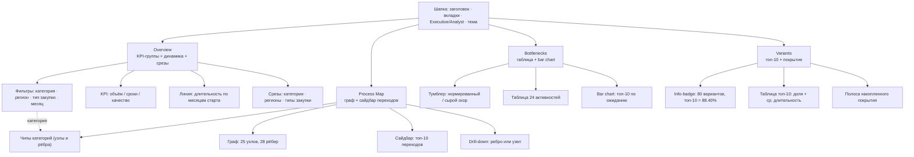

# Wireframe: сайт Process Mining MVP

**Статус:** согласован 2026-10-31 (шаг 3 Task 4)
**Дата:** 2026-10-31
**Основа:** `spec/spec.md` §6, §11, §12; `spec/design.md`; фактические JSON в `site/data/`.
**Стек:** HTML + vanilla JS + Plotly.js (CDN) + CSS-переменные. Без бэкенда, GitHub Pages.

---

## 1. Что утверждаем

Пять решений, которые дальше нельзя менять дёшево:

1. **Четыре вкладки**: Overview / Process Map / Bottlenecks / Variants. Порядок = путь читателя:
   «сколько это стоит» → «как устроен процесс» → «где стоит» → «насколько процесс разный».
2. **Режим Executive / Analyst** — один переключатель в шапке, сохраняется в `localStorage`.
3. **Фильтры живут внутри вкладок, а не в глобальной панели.** Причина в §9: JSON не позволяет
   честно отфильтровать граф по региону/типу/месяцу. Глобальная панель создала бы фильтры,
   которые «есть, но не работают».
4. **Process Map = scatter + линии** (DATA-T4-03), сайдбар топ-10 переходов, drill-down по ребру.
5. **Честность подписей**: `share_of_cases` у Legal Review > 1 подписывается как «переходов на кейс»;
   `bottleneck_score` показывается и сырой, и нормированный; стоимость потерь — сумма, а не «цена дня».

---

## 2. Информационная архитектура



---

## 3. Каркас страницы (1280px)

```
┌──────────────────────────────────────────────────────────────────────────────┐
│ HEADER  (фон --bg-header, акцентная линия 3px снизу)                          │
│  Process Mining · Закупки и контрактация        [Overview][Map][Bottlenecks] │
│  50 000 кейсов · 2024                          [Variants]  (Exec|Analyst) (☾) │
├──────────────────────────────────────────────────────────────────────────────┤
│  <main class="container">   max-width 1280, padding 0 16, вертикальный ритм 4 │
│                                                                              │
│  ┌─ строка вкладки ─────────────────────────────────────────────────────────┐│
│  │                                                                          ││
│  │   ...содержимое активной вкладки (см. §4–§7)...                           ││
│  │                                                                          ││
│  └──────────────────────────────────────────────────────────────────────────┘│
│                                                                              │
│  FOOTER: синтетические данные (SEED=42) · pm4py 2.7 · исходники JSON (4)      │
└──────────────────────────────────────────────────────────────────────────────┘
```

**Шапка:** высота по контенту (padding 24/20), sticky не нужна — вкладок четыре, переход быстрый.
На узких экранах (< 900px) вкладки уезжают во вторую строку, переключатель режима остаётся справа.

**Переключатель режима:** сегментированный контрол `Executive | Analyst` (не чекбокс — состояние видно).
**Тема:** кнопка-иконка ☾/☀, значение в `localStorage` (`pm-theme`), по умолчанию светлая.

---

## 4. Вкладка Overview

```
┌ Overview ────────────────────────────────────────────────────────────────────┐
│ ФИЛЬТРЫ (sticky внутри вкладки, чипы + селекты)                               │
│  Категория: [Все ▾]  Регион: [Все ▾]  Тип закупки: [Все ▾]  Месяц: [Все ▾]   │
│  Сброс · «Срез: все категории, все регионы»                                   │
├──────────────────────────────────────────────────────────────────────────────┤
│ KPI-ГРУППЫ  (3 колонки, в каждой карточка с 3 метриками)                      │
│ ┌── Объём ────────────┐ ┌── Сроки ────────────┐ ┌── Качество ─────────┐      │
│ │ 50 000   кейсов     │ │ 35.7 дн  средняя    │ │ 4.82 %  отменённые  │      │
│ │ 1 094 474 событий   │ │ 33.3 дн  медиана    │ │ 14.82 % с возвратом │      │
│ │ 100 поставщиков     │ │ 54.3 дн  P90        │ │ 39.87 % импортные   │      │
│ └─────────────────────┘ └─────────────────────┘ └─────────────────────┘      │
│  (Analyst: под каждой метрикой — строка формулы; Executive — только hint)     │
├──────────────────────────────────────────────────────────────────────────────┤
│ ┌─ Длительность по месяцам старта (2/3 ширины) ──────┐ ┌─ Лучший / худший ─┐ │
│ │  36.0 ┤        •                                   │ │ DEC 2024          │ │
│ │  35.9 ┤   •  •   •     •                           │ │ 35.51 дн · 4 215  │ │
│ │  35.8 ┤ •        •  •     •                        │ │ ─────────────     │ │
│ │  35.7 ┤              •  •  •                       │ │ AUG 2024          │ │
│ │       └─01──02──03──04──05──06──07──08──09──10──11─ │ │ 35.91 дн · 4 263  │ │
│ │  Линия: средняя длительность, дн.  Bars: кейсы.     │ │ Δ 0.40 дн         │ │
│ │  Клик по месяцу = выбрать срез месяца.              │ └───────────────────┘ │
│ └────────────────────────────────────────────────────┘                        │
├──────────────────────────────────────────────────────────────────────────────┤
│ ┌─ По категориям (1/2) ──────────────────────────────┐ ┌─ По регионам (1/2) ┐│
│ │ ЗИП            ████████████ 10 056 · 35.8 дн       │ │ [та же таблица,    ││
│ │ Обслуживание   ████████████  9 972 · 35.9 дн       │ │  колонки: регион,  ││
│ │ Подрядные      ████████████ 10 050 · 35.6 дн       │ │  кейсы, ср. дн]    ││
│ │ (Executive: топ-3 + «показать все»; Analyst: все 5) │ │ Тип закупки — ниже ││
│ └────────────────────────────────────────────────────┘ └────────────────────┘│
└──────────────────────────────────────────────────────────────────────────────┘
```

**Поведение фильтров (важно):** KPI-группы всегда показывают **весь лог** — в JSON нет
пересечения «категория × регион × месяц», поэтому пересчитать 9 KPI под фильтр нельзя.
Выбранный срез показывается отдельной строкой-плашкой («Срез: ЗИП, Урал, 2024-08») и меняет
только то, что действительно есть в данных:

| Что выбрано | Что меняется на Overview |
|---|---|
| Категория | линия становится `monthly_by_category` для этой категории; таблица категорий выделяет строку; плашка среза показывает `by_category` (кейсы, стоимость, ср. дн) |
| Регион | плашка среза из `by_region` + подсветка строки |
| Тип закупки | плашка среза из `by_procurement_type` + подсветка строки |
| Месяц | вертикальная линия-маркер на графике + плашка из `monthly` (кейсы, ср. дн, доля отмен) |

Если фильтры не выбраны — плашки среза нет, линия общая. Никаких «пустых» состояний:
любая комбинация сводится к одной активной плашке (приоритет: месяц > категория > регион > тип).

---

## 5. Вкладка Process Map

```
┌ Process Map ─────────────────────────────────────────────────────────────────┐
│ Легенда:  ● старт   ● конец   ● узкое место   ● обычная   ─── возврат        │
│ Категории: [Все] [ЗИП] [Обслуживание] [Подрядные] [Спецтехника] [Реагенты]    │
│ Рёбра: (Топ-10 | Все 28)                                                     │
├───────────────────────────────────────────────────┬──────────────────────────┤
│                                                   │ ПЕРЕХОДЫ (топ-10)        │
│        ●Requisition ──●TechReview ──●RFQ          │ 1. Draft → LegalStart    │
│             │              │           │          │    56 935 · 0.26 дн      │
│        ●Evaluation ───●Draft ──●LegalStart        │ 2. LegalStart → Done     │
│                          │  ↖──────┐             │    56 678 · 4.11 дн      │
│                     ●LegalDone ─────┘ (возврат)   │ 3. Requisition → Tech    │
│                          │                        │    50 000 · 0.26 дн      │
│                     ●HSE ─●Signature ─●Signed     │ ...                      │
│                          │                        │ 10. PO → Goods Shipped   │
│                     ●PO ─●Shipped ─●Customs*      │    47 602 · 0.26 дн      │
│                          │       └─●Inbound       │                          │
│                     ●Invoice ─●Payment            │ [клик → drill-down]      │
│                                                   │                          │
│  * Customs Clearance — узкое место (норм. 0.867)   │                          │
│  Hover: активность · кейсов · ожидание · скор      │                          │
└───────────────────────────────────────────────────┴──────────────────────────┘
┌ Drill-down (боковая панель, выезжает справа, 360px) ────────────────────────┐
│ Draft Contract Created → Legal Review Started            [×]                 │
│ Частота: 56 935 переходов · 100% кейсов                                      │
│ Средняя длительность: 0.26 дн · тип: прямой переход                          │
│ Куда ведёт дальше: Legal Review Completed (56 678)                           │
│ [Показать на графе] [Скопировать как текст]                                  │
└──────────────────────────────────────────────────────────────────────────────┘
```

**Раскладка:** `x = avg_position` (средний индекс события в кейсе), `y` — детерминированное
смещение 0 / +0.35 / −0.35, чтобы 25 узлов не слипались. Позиции не зависят от фильтра —
граф не «прыгает».

**Фильтр категории пересчитывает граф целиком:** и размер узлов (`frequency_by_category`), и рёбра
(`edges_by_category` — 28 переходов на каждую из 5 категорий, сумма частот сходится с общим графом
до перехода). Набор узлов при этом не меняется: все 25 активностей присутствуют в каждой категории,
меняются только частоты и толщина рёбер. Подпись над графом: «Категория: ЗИП · 10 056 кейсов».

**Клик по ребру** открывает drill-down. **Клик по узлу** — карточку активности (кейсы, ожидание,
скор, входящие/исходящие переходы). Клик по пустому месту закрывает панель. `Esc` — тоже.

---

## 6. Вкладка Bottlenecks

```
┌ Bottlenecks ─────────────────────────────────────────────────────────────────┐
│ ⓘ Скор нормирован на долю кейсов: Customs Clearance 2.29 → 0.87.              │
│   Без нормировки редкая таможня выглядела бы в 6.5 раза хуже процессных этапов.│
│   Сортировка: [Нормированный скор ▾]   Показывать: (Топ-10 | Все 24)          │
├──────────────────────────────────────────────────────────────────────────────┤
│ ┌─ Топ-3 карточки ──────────────────────────────────────────────────────────┐ │
│ │ 1. Customs Clearance      2. Legal Review Started   3. Legal Review Compl.│ │
│ │    10.6 дн · 0.867            4.1 дн · 0.399            4.1 дн · 0.391    │ │
│ │    60.3 млрд ₽ · 37.9% кейсов 69.9 млрд ₽ · 113% пер.  69.0 млрд ₽ · 113% │ │
│ └───────────────────────────────────────────────────────────────────────────┘ │
├──────────────────────────────────────────────────────────────────────────────┤
│ ┌─ Bar chart: топ-10 по ожиданию, дн ───────────────────────────────────────┐ │
│ │ Customs Clearance   ████████████████████████ 10.62                        │ │
│ │ Legal Review Started██████████ 4.11                                       │ │
│ │ Technical Review Co ██████████ 4.11                                       │ │
│ │ ...                                                                       │ │
│ └───────────────────────────────────────────────────────────────────────────┘ │
├──────────────────────────────────────────────────────────────────────────────┤
│ ТАБЛИЦА                                                                       │
│ № │ Активность            │ Ожидание, дн │ σ    │ Переходов │ Пер./кейс │ Скор │ Стоимость, млрд ₽ │
│ 1 │ Customs Clearance     │ 10.62        │ 9.50 │ 18 967    │ 0.38      │ 0.867│ 60.3              │
│ 2 │ Legal Review Started  │  4.11        │ 3.79 │ 56 678    │ 1.13      │ 0.399│ 69.9              │
│ 3 │ Legal Review Completed│  4.11        │ 3.74 │ 56 396    │ 1.13      │ 0.391│ 69.0              │
│   │ ...                   │              │      │           │           │      │                   │
│   Analyst добавляет: сырой скор (2.2855) и формулу в подвале таблицы.         │
│   Executive скрывает: σ, сырой скор, «Пер./кейс».                              │
└──────────────────────────────────────────────────────────────────────────────┘
```

**Тумблер сортировки** «Нормированный скор / Сырой скор» — переключает и таблицу, и bar chart,
и порядок топ-3. Подпись под таблицей объясняет разницу в одну строку.

**Две стоимости** (см. §10): колонка «Стоимость, млрд ₽» — честная сумма потерь (DATA-T4-05),
а не «цена дня». В Executive-режиме она остаётся: именно она показывает, что дороже всех
в сумме — не таможня, а юридическая экспертиза.

**Подпись «Пер./кейс»**: 1.13 — это «переходов на кейс», а не «доля кейсов»; в Executive-режиме
колонка скрыта, в Analyst — есть сноска.

---

## 7. Вкладка Variants

```
┌ Variants ────────────────────────────────────────────────────────────────────┐
│ ⓘ 80 уникальных вариантов. Топ-10 покрывают 88.40% кейсов, остальные 70 — 11.59%.│
│   Вариант = полная последовательность активностей кейса.                        │
├──────────────────────────────────────────────────────────────────────────────┤
│ ┌─ Накопленное покрытие ────────────────────────────────────────────────────┐ │
│ │ 100% ┤                                          ╭──────                   │ │
│ │  88% ┤                                    ╭─────╯                          │ │
│ │  50% ┤              ╭─────────────────────╯                              │ │
│ │  25% ┤──────╮───────╯                                                     │ │
│ │      └─1──2──3──4──5──6──7──8──9──10─▶ (70 вариантов: 11.59%)             │ │
│ └───────────────────────────────────────────────────────────────────────────┘ │
├──────────────────────────────────────────────────────────────────────────────┤
│ ТАБЛИЦА ТОП-10                                                                │
│ # │ Вариант (путь)                                   │ Кейсов │ Доля  │ Ср. дн│
│ 1 │ Requisition → Tech… → Legal… → Payment (22 шага)  │ 12 811 │ 25.62%│ 31.7  │
│   │   ▸ раскрыть (полный путь, 22 активности)         │        │       │       │
│ 2 │ Requisition → … → Payment (23 шага)               │  8 563 │ 17.13%│ 42.0  │
│ … │                                                   │        │       │       │
│10 │ …                                                 │  1 198 │  2.40%│ 38.9  │
│   │ Итого топ-10                                      │ 44 198 │ 88.40%│       │
└──────────────────────────────────────────────────────────────────────────────┘
```

**Путь в таблице** обрезается до 6–8 шагов с «…», полный раскрывается кликом по строке
(аккордеон, без модалок). Executive-режим: топ-5 + полосы доли, без колонки «Кейсов».
Analyst: топ-10, кейсы, доля, длительность, итоговая строка.

**Почему не график вариантов:** 80 последовательностей в одном графике нечитаемы, а таблица
с сортировкой полезнее. Единственный график — накопленное покрытие: он отвечает на вопрос
«сколько процесса описано топ-10».

---

## 8. Executive / Analyst

| Элемент | Executive (по умолчанию) | Analyst |
|---|---|---|
| KPI-карточки | значение + короткая подпись | + строка формулы |
| Overview: срезы | топ-3 + «показать все» | все строки, сортировка по клику |
| Bottlenecks: σ, сырой скор, «пер./кейс» | скрыты | показаны |
| Bottlenecks: тумблер скора | только нормированный | нормированный + сырой |
| Variants | топ-5, полосы доли | топ-10, кейсы, итоговая строка |
| Process Map: сайдбар | топ-10 | топ-10 + частота и длительность каждого |
| Подвал страницы | «синтетические данные» | + ссылки на 4 JSON и `docs/decision-log.md` |

Переключатель один на весь сайт, значение в `localStorage` (`pm-mode`), по умолчанию `executive`.
При переключении **не перезагружаем страницу** и не теряем активную вкладку/фильтры.

---

## 9. Матрица «фильтр × вкладка»

Честная карта того, что реально поддержано данными:

| Контрол | Overview | Process Map | Bottlenecks | Variants |
|---|---|---|---|---|
| Категория | срез + линия `monthly_by_category` | узлы и рёбра (`frequency_by_category`, `edges_by_category`) | — | — |
| Регион | срез `by_region` | — | — | — |
| Тип закупки | срез `by_procurement_type` | — | — | — |
| Месяц | маркер + срез `monthly` | — | — | — |
| Топ-10 / все | — | рёбра | таблица | таблица |
| Скор: норм./сырой | — | — | да | — |

Пустых контролов не рисуем: там, где фильтра нет, его просто нет (а не disabled-селект).

---

## 10. Согласованные решения (2026-10-31)

| Вопрос | Решение | Следствие |
|---|---|---|
| Фильтры: глобальная панель или внутри вкладок | **Внутри вкладок** | Overview — 4 фильтра, Process Map — чипы категорий, Bottlenecks/Variants без фильтров (см. §9) |
| KPI при выборе фильтра | **Всегда по всему логу**, срез — отдельной плашкой | Новые агрегаты не нужны; подпись «Срез: …» объясняет разницу |
| `edges_by_category` | **Добавлено сразу** | Фильтр категории пересчитывает узлы и рёбра; `process_map.json` вырос до 28.3 КБ |
| Колонка «Стоимость потерь» в Executive | **Оставлена** | Главный инсайт: суммарно дороже юр. экспертиза (69.9 млрд), а на кейс — таможня (0.867) |
| Подпись `share_of_cases` | **«Переходов на кейс»** (принято по умолчанию) | В Analyst-режиме сноска: значение > 1 — это повторные переходы, а не доля кейсов |

Открытых вопросов к вёрстке не осталось.

---

## 11. Состояния и техника

| Состояние | Поведение |
|---|---|
| Загрузка JSON | скелетоны карточек + «Загружаю данные…» в области графика |
| Ошибка fetch | карточка «Не удалось загрузить `site/data/*.json`. Запустите `python tools/csv_to_json.py`» |
| Нет данных (пустой массив) | «Нет данных для выбранного среза» + кнопка «Сбросить фильтры» |
| Нет Plotly (CDN недоступен) | текстовая заглушка + таблица остаётся рабочей |
| Узкий экран (< 900px) | одна колонка, сайдбар Process Map уезжает под граф |
| Печать / PDF | скрыть фильтры и переключатели, оставить KPI и таблицы |

**Локальный запуск:** `fetch` к `file://` в Chrome блокируется, поэтому проверка —
`python -m http.server 8000` из корня проекта и `http://localhost:8000/site/`.
На GitHub Pages ограничение не действует.

**Доступность:** все интерактивные элементы — `button`/`select`, фокус-кольцо 3px,
`aria-pressed` на сегментированных контролах, подписи графиков дублируются таблицей.

---

## 12. Что дальше

После согласования: шаги 4–8 плана (каркас → Process Map → Bottlenecks → Variants → стилизация),
затем `docs/analytics.md` с тремя инсайтами и скриншоты для README (Task 5).
