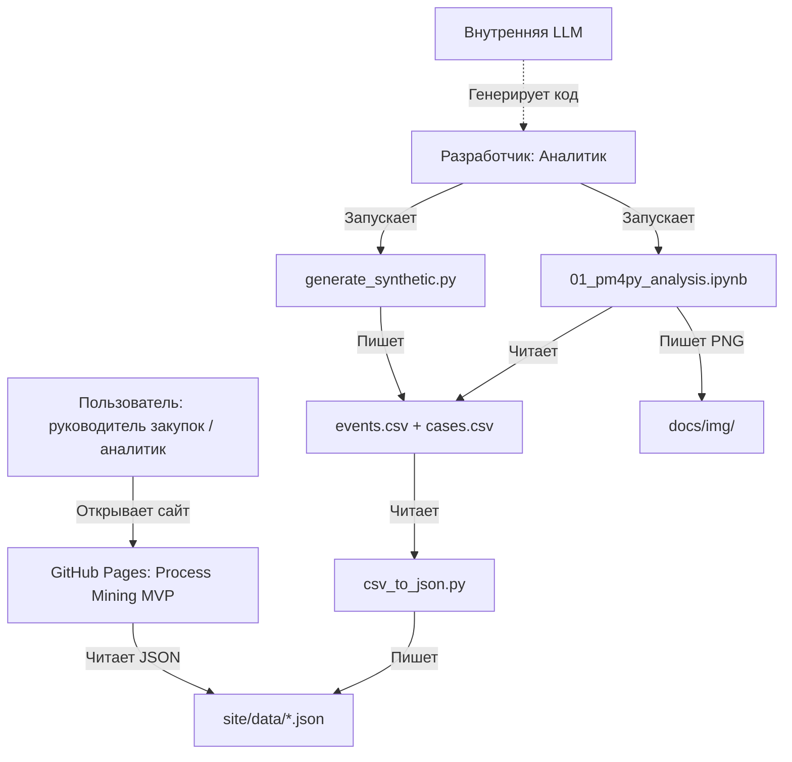
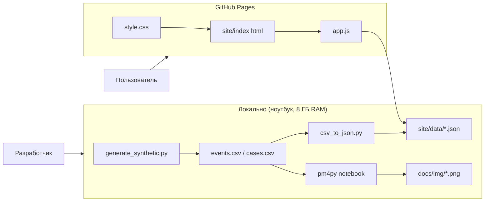

# Спецификация: Process Mining MVP для закупок и контрактации

Этот документ — главная спецификация платформы. Он описывает цели, аудиторию, пользовательские сценарии и критерии приемки (AC). Это "источник истины" для проверки того, что мы построили именно то, что планировали.

**Версия:** 1.0
**Дата:** 2026-10-29
**Автор:** Аналитик
**Контекст:** портфолио под вакансию в Центре компетенций, центр компетенций Process Mining

---

## 1. Goal (Цель)

Построить **MVP Process Mining-платформы** для анализа процесса «закупка → контрактация» в горнодобывающем холдинге, который:

1. Показывает **реальный маршрут** закупки (AS-IS) по event log, без ручного рисования BPMN.
2. Выявляет **узкие места** и считает **стоимость простоя** из-за задержек.
3. Работает **без закупки Celonis** — на открытых библиотеках (pm4py, pandas, Plotly) и внутренней LLM как оркестраторе.
4. Разворачивается **локально (DuckDB)** и публикуется **на GitHub Pages** (статический демо-сайт).

**Принцип пилота (со слов руководителя Центра компетенций):**
> «Минимум входа — максимум результата. Строим AS-IS на лету по данным, без предварительного описания процессов.»

**Фактический масштаб данных (v1.0):** 50 000 кейсов, 1 094 474 события, 25 активностей, период 2024-01 — 2024-12 (12 месяцев).

## 2. Audience (Пользователи)

| Роль | Что хочет увидеть | Где в UI |
|---|---|---|
| **Руководитель закупок** | Где теряем время и деньги, топ-3 узких места | Overview (KPI: стоимость простоя, средняя длительность) |
| **Специалист по закупкам** | Почему конкретная заявка «зависла», кто виноват | Process Map + drill-down к переходу/активности |
| **Технолог / главный механик** | Как долго идёт инженерное согласование для ЗИП | Bottlenecks (фильтр по категории) |
| **Юрист** | Сколько кейсов прошло Legal Review, сколько раз возвращались | Bottlenecks + Variant Analysis |

## 3. Problem (Проблема)

В горнодобывающем холдинге закупка ЗИП (запасных частей) и спецтехники — **критичный процесс**: простой экскаватора или самосвала стоит **от 500 тыс. до 2 млн руб. в день**. При этом:

- Нет прозрачности: непонятно, на каком этапе «застревает» заявка.
- Нет цифр: длительность этапов не измеряется системно.
- Нет приоритизации: срочные и критичные заявки закрываются не быстрее обычных.
- Ручной анализ логов (Excel, Python) — долго и не воспроизводимо.

**Центр компетенций хочет** построить центр компетенций, который это исправит — **без закупки Celonis**, на внутренней LLM.

## 4. User Journey (Основной сценарий)

1. Пользователь открывает `site/index.html` (GitHub Pages).
2. Видит **Overview**: KPI-карточки (общая стоимость простоя, средняя длительность, топ-категория).
3. Переключается на **Process Map**: видит граф процесса (DFG), толщина рёбер = частота, цвет = длительность.
4. Кликает на «красное» ребро (узкое место) → **drill-down** с агрегатами перехода: частота, уникальные кейсы, медиана/P90. Список конкретных кейсов — второй этап, в текущем JSON его нет.
5. Переключается на **Bottlenecks**: таблица «этап → средняя длительность → вариативность → стоимость простоя», топ-3 этапа.
6. Применяет фильтр по категории (например, «ЗИП») → видит, что для ЗИП главное узкое место — таможня (Customs Clearance).
7. (Опционально) Открывает ноутбук `01_pm4py_analysis.ipynb` → видит Petri net, variant analysis, расчёт потерь.

## 5. Acceptance Criteria (Критерии приёмки)

Все AC в формате **Given/When/Then** и проверяемы. Период P = весь датасет (12 месяцев 2024).

| № | Критерий |
|---|---|
| **AC-1** | Given `events.csv` сгенерирован, When запускается `tools/validate.py`, Then скрипт проверяет: наличие колонок `case_id, activity, timestamp, resource`; отсутствие NULL в `case_id` и `timestamp`; монотонность времени внутри кейса; выводит «OK» и количество кейсов/событий. |
| **AC-2** | Given `events.csv` и `cases.csv` загружены в pm4py, When строится DFG (Directly-Follows Graph), Then в графе ≥ 20 узлов (активностей) и ≥ 25 рёбер (переходов). |
| **AC-3** | Given DFG построен, When пользователь открывает `site/index.html` вкладку **Process Map**, Then граф отображается, толщина рёбер пропорциональна частоте, цвет — средней длительности перехода. |
| **AC-4** | Given датасет загружен, When считается метрика «стоимость простоя», Then для каждого кейса: `duration_days × downtime_cost_per_day`, сумма по всем кейсам выводится в Overview. |
| **AC-5** | Given датасет загружен, When строится variant analysis, Then выводится топ-10 вариантов процесса (уникальных последовательностей активностей), их частота и средняя длительность; самый частый вариант покрывает ≥ 25% кейсов (факт 25.62%, см. `docs/decision-log.md` AC-T4-01). |
| **AC-6** | Given датасет загружен, When считается bottleneck-метрика, Then для каждой активности: средняя длительность (между входом и выходом), стандартное отклонение, доля кейсов с задержкой > P90. Топ-3 по вкладу в общую длительность выводятся в Bottlenecks. |
| **AC-7** | Given пользователь выбрал фильтр `category = "ЗИП (запчасти)"` на вкладке **Обзор**, When применяет, Then виджеты Overview пересчитываются по этому срезу. На вкладке **Карта процесса** аналогичный фильтр выбирается собственными чипами категорий и перестраивает граф и таблицу переходов. |
| **AC-8** | Given пользователь кликнул на ребро в Process Map, When срабатывает drill-down, Then открывается панель с агрегатами перехода: `activity`, `next_activity`, частота, уникальные кейсы, переходов на кейс, средняя/медиана/P90. Case-level таблица (`case_id`, `supplier`, `amount`, …) — второй этап. |
| **AC-9** | Given ноутбук `01_pm4py_analysis.ipynb` открыт, When запускаются все ячейки, Then ноутбук выполняется без ошибок, строит Petri net (через Inductive Miner), variant analysis, bottleneck-таблицу, сохраняет 4 PNG в `docs/img/`. |
| **AC-10** | Given сайт открыт на GitHub Pages, When пользователь переключает тему (светлая/тёмная), Then тема меняется и сохраняется в `localStorage`. |
| **AC-11** | Given `README.md` открыт, When пользователь читает, Then он видит: описание, стек, инструкцию запуска, скриншоты, ссылку на демо. |
| **AC-12** | Given `docs/c4.md` открыт, When пользователь читает, Then он видит C4 Level 1 (Context) и Level 2 (Container) в Mermaid. |
| **AC-13** | Given датасет загружен, When открывается variants.json, Then share_percent для топ-10 вариантов в сумме ≤ 100%, каждый ≤ 100%. |

## 6. Структура UI (вкладки)

Реализовано **4 вкладки**.

| Вкладка | Что показывает | Источник данных | Фильтры |
|---|---|---|---|
| **Overview (Обзор)** | KPI-группы (объём/сроки/качество), мини-KPI, executive summary, график «Длительность по месяцам старта», кольцевая диаграмма «Структура потерь», таблица «По категориям», стек «Кейсы по типам закупки». | `site/data/overview.json` | **Фильтры вкладки**: категория, регион, тип закупки, месяц. Работают по предагрегированным срезам (`by_category`, `by_region`, `by_procurement_type`, `by_category_region`, `by_category_type`, `by_region_type`, `monthly_by_*`). При сочетании >2 фильтров без предагрегации виджеты переходят в empty-state. |
| **Process Map (Карта процесса)** | Две визуализации: DFG-панель на Cytoscape (зум, Fit, раскладка) и Plotly-карта «Карта процесса». Узлы = активности, рёбра = переходы. Толщина = частота, цвет = длительность перехода. Режимы: **DFG** (все переходы), **Один вариант** (по топ-варианту), **Диапазон** (топ-N по диапазону). Таблица «Длительность переходов» с метрикой (среднее/медиана/P90) и пагинацией. Панель деталей перехода/узла. | `site/data/process_map.json`, `site/data/variant_paths.json` | Фильтр по категории (чипы по категориям из `overview.by_category`) и кнопки «Таможня»/«Без таможни». Фильтр по количеству переходов (Топ-10/Все 28). Диапазон шагов 1…22. |
| **Bottlenecks (Узкие места)** | Топ-3, bar-chart «Среднее ожидание по активностям», scatter «Ожидание vs. потери», таблица активностей с сортировкой (нормированный скор/сырой скор/среднее ожидание/стоимость потерь). В режиме Executive опция «сырой скор» скрыта. | `site/data/bottlenecks.json` | Нет фильтров по измерениям. Сортировка и режим «Топ-10/Все 24». |
| **Variants (Варианты)** | Pareto «доля кейсов по вариантам» (топ-10 + «прочие»), «Идеальный маршрут» (топ-1 вариант), таблица топ-10 вариантов с разворачиваемым полным путём. | `site/data/variants.json`, `site/data/variant_paths.json` | Нет фильтров по измерениям. |

## 7. Edge Cases (Граничные случаи)

| Случай | Поведение |
|---|---|
| Кейс без завершения (нет `Payment Made`) | Не попадает в variant analysis, но считается в «незавершённые» (KPI «in progress»). |
| Дублирование события (один `timestamp`, одна активность) | `validate.py` предупреждает, но не блокирует. В анализе — дедупликация по `(case_id, activity, timestamp)`. |
| Рассинхрон времени (событие «раньше» предыдущего) | `validate.py` помечает кейс как «аномалия», исключает из DFG. |
| Единственный поставщик (без RFQ/Bids/Evaluation) | Считается валидным вариантом процесса, но помечается `procurement_type = "Единственный поставщик"`. |
| Отменённый кейс (`is_rejected = 1`) | Не попадает в «средняя длительность», но учитывается в «доля отменённых». |
| Пустой `events.csv` | Сайт показывает «Нет данных, запустите генератор». |
| Импортный кейс (без таможни) | Если is_import=1 и is_rejected=0, Customs Clearance обязательна. Если is_rejected=1, таможня может отсутствовать (кейс отменён) |

## 8. Non-Functional Requirements (NFR)

| Категория | Требование |
| --- | --- |
| **Производительность** | Генерация 50 тыс. кейсов (1.1 млн событий) ≤ 60 сек на ноутбуке. |
| **Размер данных** | `events.csv` ≤ 270 МБ, **не коммитится** (генерируется локально, seed фиксирован). `site/data/*.json` ≤ 5 МБ (агрегаты, не сырые события). |
| **Совместимость** | Chrome, Edge, Firefox (последние 2 версии). Мобильный — не приоритет (десктоп). |
| **Доступность** | GitHub Pages, HTTPS, без бэкенда. |
| **Безопасность** | Нет ПДн, только `supplier_001`, `employee_role`. Нет API-ключей в коде. |
| **Воспроизводимость** | `SEED = 42`, все зависимости в `requirements.txt`. |
| **Наблюдаемость** | Логи генератора — в `logs/`, не в Git. |
| **Тестируемость** | `tools/validate.py` проверяет XES-совместимость. |

## 9. Модель данных (краткая версия)

Подробно — в `spec/data_model.md`.

### `events.csv` (event log)

| Поле | Тип | Описание |
|---|---|---|
| `case_id` | object | Уникальный ID кейса (например, `CASE-000001`) |
| `activity` | object | Название активности (например, `Requisition Created`) |
| `timestamp` | ISO 8601 | Время события |
| `resource` | object | Роль исполнителя (например, `Специалист по закупкам`) |
| `phase` | object | Фаза процесса (`sourcing`, `contracting`, `logistics`, `execution`) |
| `source_system` | object | Система-источник (`SAP SRM`, `SAP ERP`) |
| `document_type` | object | Тип документа (пока пусто) |
| `document_status` | object | Статус документа (пока пусто) |
| `category` | object | Категория закупки (ЗИП, расходники БВР, ...) |
| `procurement_type` | object | Тип закупки |
| `region` | object | Регион |
| `department` | object | Подразделение |
| `supplier` | object | Поставщик (`Поставщик_001`) |
| `amount` | float64 | Сумма контракта, руб |
| `is_import` | int64 | 0/1 |
| `is_rejected` | int64 | 0/1 |
| `downtime_cost_per_day` | int | Стоимость простоя, руб/день |

### `cases.csv` (атрибуты кейса)

Те же поля, кроме `activity`, `timestamp`, `resource`, `phase`, `source_system`, `document_type`, `document_status`.

## 10. Activity Dictionary (краткая версия)

Подробно — в `spec/activity_dictionary.md`.

| Активность | Фаза | Роль | Обязательна |
|---|---|---|---|
| `Requisition Created` | sourcing | Специалист по закупкам | Да |
| `Technical Review Started` | sourcing | Главный механик | Да |
| `Technical Review Completed` | sourcing | Главный механик | Да |
| `RFQ Sent to Suppliers` | sourcing | Специалист по закупкам | Да (кроме единственного поставщика) |
| `Bids Received` | sourcing | Специалист по закупкам | Да (кроме ед. поставщика) |
| `Evaluation Started` | sourcing | Специалист по закупкам | Да (кроме ед. поставщика) |
| `Evaluation Completed` | sourcing | Специалист по закупкам | Да (кроме ед. поставщика) |
| `Draft Contract Created` | contracting | Специалист по договорам | Да |
| `Legal Review Started` | contracting | Юрист | Да |
| `Legal Review Completed` | contracting | Юрист | Да |
| `HSE Review Started` | contracting | Специалист ОТиПБ | Да |
| `HSE Review Completed` | contracting | Специалист ОТиПБ | Да |
| `Negotiation Started` | contracting | Специалист по закупкам | Нет (30%) |
| `Revised Draft Created` | contracting | Специалист по договорам | Нет (30%) |
| `Signature Requested` | contracting | Специалист по договорам | Да |
| `Signed by Buyer` | contracting | Руководитель | Да |
| `Signed by Supplier` | contracting | Поставщик | Да |
| `PO Issued` | execution | Специалист по закупкам | Да |
| `Goods Shipped` | logistics | Поставщик | Да |
| `Customs Clearance` | logistics | Логист | Нет (только импорт) |
| `Inbound to Central Warehouse` | logistics | Логист | Да |
| `Dispatch to Mine Site` | logistics | Логист | Да |
| `Goods Received at Site` | execution | Кладовщик | Да |
| `Invoice Received` | execution | Бухгалтер | Да |
| `Payment Made` | execution | Бухгалтер | Да |

**Всего:** 25 активностей (24 обязательных + `Customs Clearance` — только для импортных кейсов). В сгенерированном логе присутствуют все 25.

## 11. Метрики

| Метрика | Формула | Где |
|---|---|---|
| **Длительность кейса** | `max(timestamp) - min(timestamp)` | Overview |
| **Стоимость простоя кейса** | `duration_days × downtime_cost_per_day` | Overview, Bottlenecks |
| **Общая стоимость простоя** | `Σ cost_per_case` | Overview |
| **Средняя длительность этапа** | `mean(duration_between_events)` | Bottlenecks |
| **Вариативность этапа** | `std(duration)` | Bottlenecks |
| **Bottleneck Score** | `(avg_duration / total_duration) × std(duration)` | Bottlenecks |
| **Доля кейсов с задержкой** | `count(duration > P90) / total` | Bottlenecks |
| **Variant frequency** | `count(cases with variant) / total_cases` | Variants |

> bottleneck_score для опциональных активностей (Customs Clearance) считается только по кейсам, где активность была. Для честного сравнения нужно нормировать на share_of_cases. В MVP — не нормируем, но в отчёте указываем контекст.

## 12. API (локальный, без бэкенда)

Сайт читает **статические JSON** из `site/data/`:

| Файл | Структура |
|---|---|
| `overview.json` | `{ generated_at, period_start, period_end, source_version, total_cases, total_events, total_cost, cost_per_case, avg_duration_days, median_duration_days, p90_duration_days, top_category, top_category_count, rejected_share, returns_share, import_share, kpi_groups {volume, time, quality}, monthly, monthly_by_category, monthly_by_region, monthly_by_type, best_month, worst_month, by_category, by_region, by_procurement_type, by_category_region, by_category_type, by_region_type, executive }` |
| `process_map.json` | `{ nodes: [...], nodes_metadata: {node: {type, cases, avg_days, bottleneck_score_normalized, avg_position}}, edges: [{activity, next_activity, frequency, avg_duration_days, median_duration_days, p90_duration_days, unique_cases}], edges_by_category: {category: [...]}, frequency_by_category: {category: {node: cases}}, edges_by_import: {import|no-import: [...]}, frequency_by_import: {import|no-import: {node: cases}} }` |
| `bottlenecks.json` | `{ bottlenecks: [{activity, avg_hours, std_hours, avg_days, std_days, transitions, share_of_cases, bottleneck_score, bottleneck_score_normalized, cost_of_delay_rub}], top3: [...] }` |
| `variants.json` | `{ total_variants, total_cases, top10_cases, top10_coverage_percent, variants: [...] }` — топ-10 с `variant`, `frequency`, `share_percent`, `avg_duration_days` |
| `variant_paths.json` | `{ total_cases, total_variants, variants: [{rank, variant, frequency, share_percent, avg_duration_days, steps: [{position, activity, cases}]}] }` — 15 путей для режимов Process Map |

**Генерация JSON:** `tools/csv_to_json.py` (читает `events.csv` + `cases.csv`, агрегирует, пишет JSON).

## 13. Технические ограничения

| Параметр | Значение |
|---|---|
| ОС | Windows 11 |

## 14. Out of Scope (явно не входит)

- ❌ PostgreSQL / Neon (второй этап).
- ❌ n8n / AI-агент в рантайме (слой на будущее).
- ❌ Conformance checking (достаточно discovery + performance).
- ❌ Celonis / Disco / UiPath (только как эталон в спеке).
- ❌ Интеграция с реальными системами ЕвроХима (SAP, MES, SCADA) — только синтетика.
- ❌ Многопользовательский доступ, авторизация.
- ❌ Мобильная версия (десктоп приоритет).

>«География: 4 региона (Кировск, Апатиты, Ковдор, Мурманск) — это Ковдорский ГОК и площадки ЕвроХима в Мурманской области. В MVP — 4 региона, в проде — все площадки холдинга».

## 15. Дорожная карта MVP

| Шаг | Задача | Артефакт | AC |
|---|---|---|---|
| 1 | Генератор синтетики | `tools/generate_synthetic.py` | AC-1 |
| 2 | Валидатор | `tools/validate.py` | AC-1 |
| 3 | CSV → JSON | `tools/csv_to_json.py` | AC-3 |
| 4 | Ноутбук pm4py | `notebooks/01_pm4py_analysis.ipynb` | AC-2, AC-5, AC-6, AC-9 |
| 5 | Сайт (4 вкладки) | `site/index.html` + `app.js` + `style.css` | AC-3, AC-4, AC-7, AC-8, AC-10 |
| 6 | C4-диаграммы | `docs/c4.md` | AC-12 |
| 7 | README + скриншоты | `README.md` | AC-11 |

## 16. ADRs (Architecture Decision Records)

| ID | Решение | Обоснование |
|---|---|---|
| **ADR-01** | DuckDB вместо PostgreSQL | embedded, без сервера |
| **ADR-02** | pm4py вместо Celonis | Открытый код, бесплатно, достаточно для MVP |
| **ADR-03** | Plotly.js вместо React | Без Node-сборки, меньше зависимостей |
| **ADR-04** | Статические JSON вместо API | GitHub Pages без бэкенда |
| **ADR-05** | Синтетика, а не реальные данные | Нет доступа к данным ЕвроХима, нет ПДн |
| **ADR-06** | 50 тыс. кейсов, а не 20 млн | Влезает в Git, достаточно для демо |
| **ADR-07** | Горнодобыча (ЗИП, таможня, HSE) | Домен ЕвроХима, отличает от госзакупок |
| **ADR-08** | LLM не в рантайме, а офлайн | В MVP — только генерация кода, без API-ключей |

## 17. C4 Level 1 — System Context

## 18. C4 Level 2 — Container

## 19. История изменений

| Дата | Версия | Автор | Изменение |
|---|---|---|---|
| 2026-10-29 | 1.0 | Аналитик | Начальная версия |
| 2026-11-02 | 1.1 | Аналитик | Актуализация под 4 вкладки, фильтры внутри вкладок, drill-down с агрегатами, 5 JSON-агрегатов |
